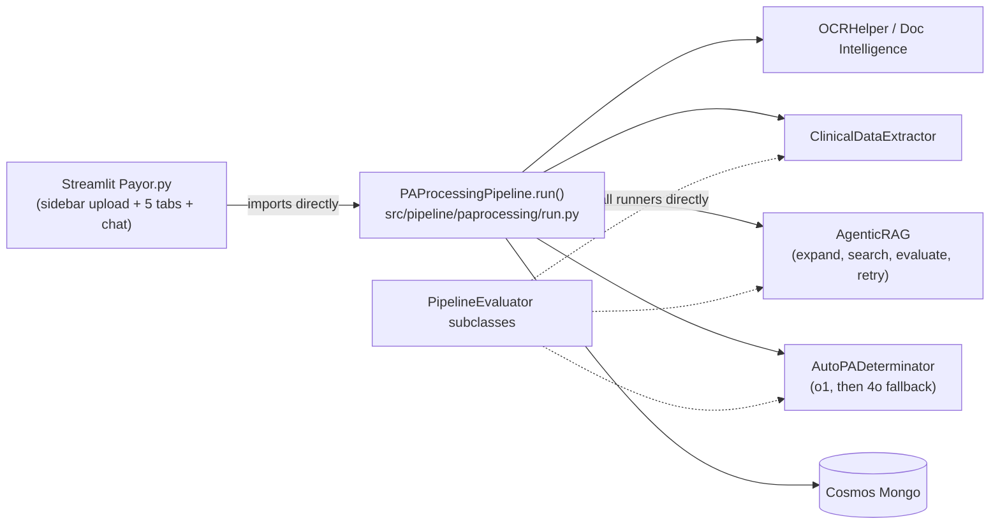
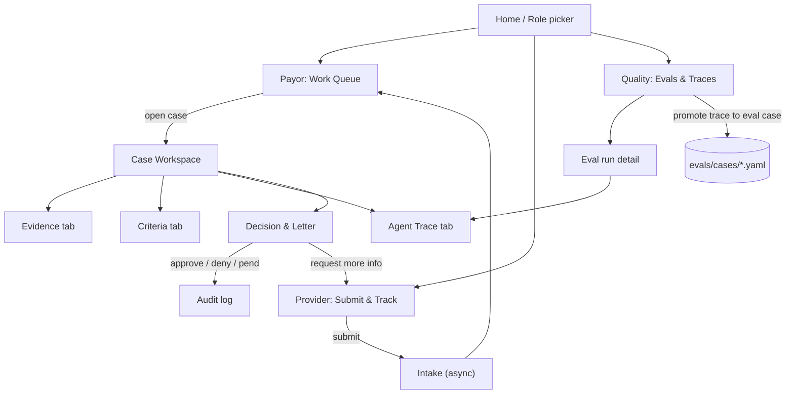
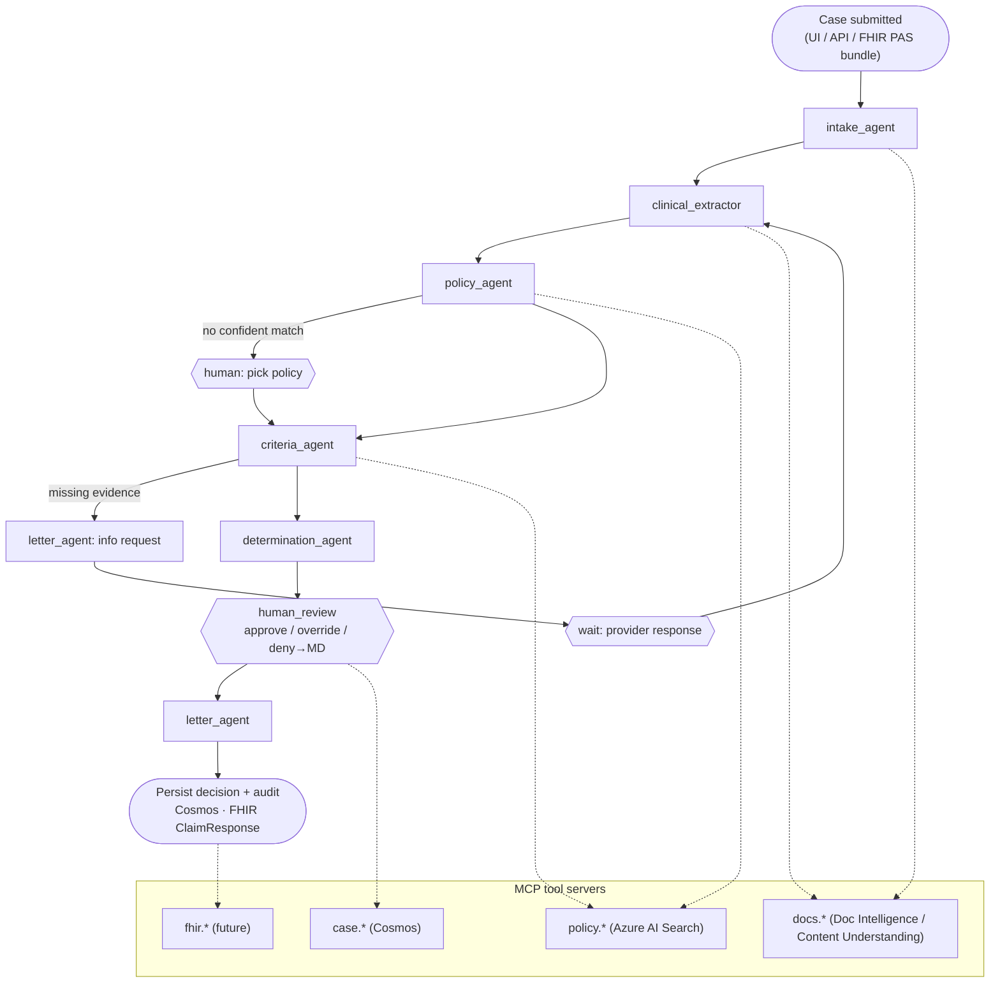
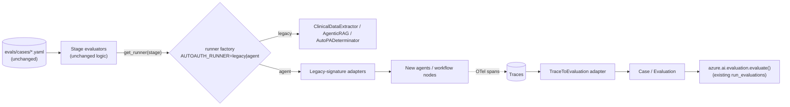

# AutoAuth: Agentic 2026 Redesign (Wireframe)

> **Status:** Proposal and wireframe. Nothing here replaces running code yet.
> **Invariant:** The eval cases in `evals/cases/*.yaml`, the `PipelineEvaluator` / `Case` / `Evaluation`
> framework in `src/evals/`, and the custom evaluators in `src/evals/custom/` remain the source of truth.
> Every new component must be scored by those assets **unchanged** before it replaces an existing one.

## 1. Goals and non-goals

| Goals | Non-goals |
|---|---|
| Move from a one-shot "upload, then wait, then read markdown" flow to a **reviewer workspace** with evidence, criteria, and a human decision. | Rewriting the eval framework or the ground-truth YAML. |
| Break the monolithic `PAProcessingPipeline` into **specialized agents behind a durable workflow**, with typed contracts and citations. | Fully autonomous denials. A human still signs off on every adverse determination. |
| Make every agent run **traceable and evaluable**, offline (YAML cases) and online (sampled production traces). | A production payer integration. FHIR / Da Vinci hooks are interface seams only. |
| Keep the existing evaluators as the regression gate through **adapters**. | Picking a UI framework in this doc. Section 3 is framework-agnostic. |

## 2. Current state (what we keep, what hurts)



**Keep (high value):**

- Stage logic and prompts: `clinicalExtractor`, `agenticRag`, `autoDetermination`, and the Jinja templates in `promptEngineering/templates`.
- Pydantic schemas in `promptEngineering/models.py` (`PatientInformation`, `PhysicianInformation`, `ClinicalInformation`).
- The eval framework and cases: 3 stage evaluators, 15 YAML case files, the custom `FuzzyEvaluator` / `FactualCorrectnessEvaluator` / `SemanticSimilarityEvaluator`, the `azure.ai.evaluation` evaluators the YAML references (Rouge, Bleu, Meteor, QA, Coherence, Retrieval), and the pytest gates in `tests/evals/`.
- Infra: Bicep + azd, AI Search hybrid index, Doc Intelligence, Cosmos, ACA.

**Pain points that drive this redesign:**

| Area | Observation (file) | Consequence |
|---|---|---|
| UI ↔ engine coupling | `paprocessing/run.py` imports `streamlit` and draws progress bars inside `run()` | You can't run the engine headless, as an API, or as an agent tool without the UI. |
| Blocking UX | `run_pipeline_with_spinner` waits on the whole pipeline (`Payor.py`) | No partial results and no streaming. A failure shows up as a blank screen. |
| Flat output | Five tabs of formatted markdown, plus an extra LLM call to turn the determination into markdown | The reviewer can't trace a claim back to the source page or the policy clause. |
| No human in the loop | The determination text is the end state. No approve, override, or request-more-info action is persisted. | No audit trail. This can't support CMS-0057-F style decision and denial-reason requirements. |
| Free-text determination | `AutoDeterminationEvaluator` makes an LLM call to *summarize the determination into JSON* and then runs `jq` | Eval scores mix determinator quality with summarizer quality. |
| Chat context | `initialize_chatbot` stuffs the whole case into the system prompt, and the patient section reads physician fields | Grounding is fragile, and the context window grows with each case. |
| Retrieval | Top-1 policy chosen deterministically (`@TODO` in `paprocessing/run.py`) | Wrong-policy errors propagate silently. |
| Eval wiring quirk | `AgenticRagEvaluator.EXPECTED_PIPELINE = "src.pipeline.clinicalExtractor.evaluator.AgenticRagEvaluator"` (the YAML matches this string) | The adapter registry must key on this **string**, not the import path. Don't "fix" it without updating the YAML. |

## 3. UI wireframes

> Clickable wireframe: [`wireframes/agentic-2026.html`](wireframes/agentic-2026.html). Built UI: [`app/frontend/web/`](../../app/frontend/web/README.md).

### 3.1 Navigation model

The current app is one page that does upload, results, and chat. The target has **role-based workspaces**, with the case as the central object.



### 3.2 Payor: Work Queue (new landing page for reviewers)

```text
┌──────────────────────────────────────────────────────────────────────────────────────┐
│ AutoAuth ▸ Work Queue                                   [Role: UM Nurse ▾] [🔔 3]    │
├──────────────────────────────────────────────────────────────────────────────────────┤
│ Filters: [Status ▾ Ready for review] [Urgency ▾ All] [Line of business ▾] [🔍 search]│
├────┬──────────┬──────────────┬───────────┬──────────────┬─────────┬───────────┬──────┤
│ ⚑  │ Case ID  │ Requested    │ Urgency   │ AI recommend │ Conf.   │ SLA left  │ Who  │
├────┼──────────┼──────────────┼───────────┼──────────────┼─────────┼───────────┼──────┤
│ 🔴 │ PA-1042  │ Adalimumab   │ Expedited │ Approve      │ ██████░ │ 14h / 72h │ –    │
│ 🟡 │ PA-1039  │ MRI L-spine  │ Standard  │ Need info    │ ███░░░░ │ 4d / 7d   │ JL   │
│ ⚪ │ PA-1037  │ Ozempic      │ Standard  │ ⏳ Agents running (3/5)  │ 6d / 7d   │ –    │
└────┴──────────┴──────────────┴───────────┴──────────────┴─────────┴───────────┴──────┘
  Row = live status from workflow events. Clicking a row opens the Case Workspace.
  "AI recommend" is never shown as final; final states are set only by a human.
```

**Why:** This replaces the sidebar "Retrieve a Case ID" dropdown. SLA timers make the CMS-0057-F timeframes visible (72h expedited, 7 days standard).

### 3.3 Payor: Case Workspace (core screen)

```text
┌──────────────────────────────────────────────────────────────────────────────────────┐
│ ◂ Queue   PA-1042 · Sarah Sample · Adalimumab · Expedited        SLA 14h  [Assign ▾] │
│ Progress: Intake ✔ ─ Extract ✔ ─ Policy ✔ ─ Criteria ✔ ─ Recommend ✔ ─ Review ●      │
├───────────────────────────┬─────────────────────────────────┬────────────────────────┤
│ ① EVIDENCE (source docs)   │ ② CRITERIA CHECKLIST            │ ③ COPILOT (case-scoped)│
│ [form.pdf][note.pdf][labs] │ Policy: Humira_Crohns_v3.pdf p2 │                        │
│ ┌───────────────────────┐ │  [open clause ↗]                │ 💬 "Why is criterion 3 │
│ │  page 2 of 6          │ │ ✔ 1 Dx Crohn's (K50.90)         │    only partial?"      │
│ │  ▓▓▓ highlighted span │◀┼──  evidence: note.pdf p1 ¶3     │                        │
│ │  "Methylprednisolone  │ │ ✔ 2 Age ≥ 6                     │ 🤖 Policy requires     │
│ │   40mg daily ..."     │ │ ◐ 3 Failed ≥1 conventional tx   │  failure of steroids   │
│ │                       │ │     steroid ✔ · immunomod ✖    │  OR immunomodulator... │
│ └───────────────────────┘ │     [Accept] [Override ▾] [📝]  │  [cite: policy p2 §B]  │
│ Extracted facts (editable) │ ✔ 4 Prescriber = GI specialist  │                        │
│ Patient  · Physician ·     │ ✖ 5 TB screening documented     │ Suggested actions:     │
│ Clinical · Treatment       │     → missing; [Request info]   │ • Draft info request   │
│ (each field ⇢ source span) │                                 │ • Compare to similar   │
├───────────────────────────┴─────────────────────────────────┴────────────────────────┤
│ ④ RECOMMENDATION  Approve (conf 0.86)  · 4/5 met, 1 missing  · model: <reasoning-model>│
│   Rationale ▸ (structured, each sentence cites a criterion + evidence span)            │
│   [ Approve ]  [ Pend: request info ]  [ Deny → requires MD review ]  [ View trace ]    │
└──────────────────────────────────────────────────────────────────────────────────────┘
```

**Design rules:**

- **Every claim is clickable.** Extracted fields, criteria, and rationale sentences each carry a `citation` (doc id, page, bbox, or policy clause id). Clicking one highlights the source in pane ①.
- **Human edits are first-class data.** An *Override* or a field edit is stored as a `ReviewerAction`. These actions become the labeled data the Quality page can promote into new YAML eval cases.
- **Deny is gated.** An adverse recommendation routes to a physician-reviewer role and requires a specific denial reason (mapped to criteria).
- **Copilot is case-scoped and tool-based.** It retrieves from the case state and the policy index through tools, instead of having the whole case pasted into a system prompt.

### 3.4 Agent Trace tab (inside the workspace)

```text
┌ Agent Trace · PA-1042 · run 7f3a… ───────────────────────────────────────────────┐
│ ▸ workflow.pa_case                                     41.2s   $0.38   ✔        │
│   ├─ intake_agent        ocr.analyze(3 docs)             6.1s           ✔        │
│   ├─ clinical_extractor  extract(Patient,Physician,Clin) 9.8s  conf .92 ✔        │
│   ├─ policy_agent        search ×2 · judge ×2 (1 retry)  8.4s  top-3    ✔        │
│   ├─ criteria_agent      policy → 5 criteria             5.0s           ✔        │
│   ├─ determination_agent reasoning model                 11.9s          ✔        │
│   └─ ⏸ human_review      waiting on UM Nurse                                     │
│ [Open in Foundry tracing ↗]   [Run evals on this trace]   [Save as eval case]   │
└──────────────────────────────────────────────────────────────────────────────────┘
```

### 3.5 Provider: Submit & Track (finishes the WIP `Provider.py`)

```text
┌ Provider Portal ─────────────────────────────────────────────────────────────────┐
│ New request                                                                     │
│  Patient [search…]  Service/Drug [Adalimumab]  Urgency (•) Expedited ( ) Std    │
│  ┌ Pre-check (runs as you attach) ─────────────────────────────────────────┐    │
│  │ Policy matched: Humira – Crohn's v3                                     │    │
│  │ ✔ Diagnosis  ✔ Prior therapy  ✖ TB screening not found  [attach]        │    │
│  └─────────────────────────────────────────────────────────────────────────┘    │
│  Documents: [drop files]  form.pdf ✔  note.pdf ✔  labs.pdf ✔                    │
│                                                    [Submit request]            │
├─────────────────────────────────────────────────────────────────────────────────┤
│ My requests:  PA-1042 Pended – info requested (TB screen)  [Respond]            │
└─────────────────────────────────────────────────────────────────────────────────┘
```

**Why:** The same criteria agent runs on both sides. Running it before submission (in the spirit of Da Vinci CRD/DTR) is the biggest lever for reducing pends.

### 3.6 Quality: Evals & Traces (new)

```text
┌ Quality ─────────────────────────────────────────────────────────────────────────┐
│ Regression gate (offline, evals/cases)            Online (sampled prod traces)  │
│ ┌──────────────────────┬────────┬────────┬──────┐  ┌──────────────────────────┐ │
│ │ Suite                │ main   │ branch │  Δ   │  │ Groundedness   0.91 ▲    │ │
│ │ ocr-ner-*            │ 0.88   │ 0.90   │ +.02 │  │ Task adherence 0.87 ─    │ │
│ │ agentic-rag-*        │ 0.75   │ 0.81   │ +.06 │  │ Override rate  7%   ▼    │ │
│ │ autodetermination-*  │ 0.93   │ 0.93   │  0   │  │ Pend rate      18%  ▼    │ │
│ └──────────────────────┴────────┴────────┴──────┘  └──────────────────────────┘ │
│ Reviewer overrides this week: 12  [Review → promote to eval case]               │
└──────────────────────────────────────────────────────────────────────────────────┘
```

### 3.7 Mapping current UI to new UI

| Today (`Payor.py`) | Target |
|---|---|
| Sidebar upload + Submit | Provider *Submit* screen, or a Payor *New case* drawer. Processing is async, and the case appears in the Queue. |
| Spinner + `st.progress` inside the engine | Stage stepper fed by workflow events (SSE / AG-UI style stream) |
| Tab "AI Determination" + Markdown/Plain toggle | Recommendation bar ④ with a structured rationale. No second LLM pass is needed to make it pretty. |
| Tabs Clinical / Physician / Patient | Editable *Extracted facts* panel with per-field citations |
| Tab "Supporting Documentation" | Evidence viewer ① with highlights, plus a policy clause link |
| Bottom chat with case pasted into the system prompt | Case-scoped Copilot ③ using tools (case state, policy search, similar cases) |
| Case ID dropdown | Work Queue |

## 4. Target agent architecture

### 4.1 Principles

1. **Workflow first, agents inside.** PA is a regulated, auditable process, so the backbone is a durable, deterministic graph. Agents do the reasoning-heavy steps; they don't choose the overall route. A free-form "manager agent" is reserved for the Copilot pane.
2. **Typed state, not strings.** Each step reads and writes a `CaseState` (Pydantic). Free text exists only inside rationale fields.
3. **Citations are mandatory outputs.** Extraction, criteria, and rationale all carry evidence pointers.
4. **Tools behind MCP.** OCR, policy search, case store, and (later) FHIR become MCP tools. Agents, the Copilot, and external clients like Copilot Studio or M365 then share one tool surface.
5. **Human checkpoint is a workflow node** (pause, wait for event, resume), not a UI convention.
6. **Every run emits OpenTelemetry GenAI spans** to App Insights / Foundry tracing, so the same trace powers the UI trace tab and the online evals.

### 4.2 Agent roster

| New agent / node | Replaces / wraps | Tools (MCP) | Output contract |
|---|---|---|---|
| `intake_agent` | `process_uploaded_files`, `OCRHelper` | `docs.ocr`, `docs.classify`, `blob.put` | `DocumentSet` (doc type, pages, layout markdown, page images) |
| `clinical_extractor` | `ClinicalDataExtractor` | `docs.read_pages` | `PatientInformation`, `PhysicianInformation`, `ClinicalInformation` **+ `citations` per field** |
| `policy_agent` | `AgenticRAG` (expand → search → judge → retry) | `policy.search` (AI Search hybrid / agentic retrieval), `policy.read` | `PolicyMatch[]` (top-k with judge reasoning, not top-1) |
| `criteria_agent` **(new)** | Implicit inside the determination prompt today | `policy.read` | `Criterion[]` (id, text, clause cite) + `CriterionAssessment[]` (met / partial / unmet / missing, evidence cites) |
| `determination_agent` | `AutoPADeterminator` | none (pure reasoning over state) | `Determination` {decision, confidence, rationale[], missing_info[]} |
| `human_review` (node) | — | UI events | `ReviewerAction[]` |
| `letter_agent` **(new)** | `update_results_with_markdown` | `templates.render` | Approval, denial, or info-request letter with reason codes |
| `case_copilot` | `initialize_chatbot` | `case.get`, `policy.search`, `case.similar` | Chat turns with citations |

### 4.3 Flow



### 4.4 Shared state (sketch)

```python
class Citation(BaseModel):
    source: Literal["document", "policy"]
    ref: str               # blob path or policy chunk id
    page: int | None = None
    span: str | None = None  # quoted text
    bbox: list[float] | None = None

class Cited(BaseModel, Generic[T]):
    value: T
    citations: list[Citation] = []
    confidence: float | None = None

class CriterionAssessment(BaseModel):
    criterion_id: str
    status: Literal["met", "partial", "unmet", "missing"]
    rationale: str
    citations: list[Citation]

class Determination(BaseModel):
    decision: Literal["Approved", "Denied", "Needs More Information"]
    confidence: float
    rationale: list[Cited[str]]
    missing_info: list[str] = []

class CaseState(BaseModel):
    case_id: str
    documents: DocumentSet | None = None
    patient: PatientInformation | None = None          # unchanged models
    physician: PhysicianInformation | None = None
    clinical: ClinicalInformation | None = None
    field_citations: dict[str, list[Citation]] = {}    # "clinical.diagnosis" -> [...]
    policies: list[PolicyMatch] = []
    criteria: list[CriterionAssessment] = []
    determination: Determination | None = None
    reviewer_actions: list[ReviewerAction] = []
    trace_id: str | None = None
```

The existing Pydantic models stay as they are. Citations live **beside** them (`field_citations`), so every eval YAML that instantiates `src.pipeline.promptEngineering.models:ClinicalInformation` keeps working.

### 4.5 Platform choices to validate (not decisions)

| Concern | Today | Candidate for 2026 |
|---|---|---|
| Orchestration | Hand-rolled async in `PAProcessingPipeline.run()` | Microsoft Agent Framework workflows (successor to the SK scaffolding in `src/agenticai`), hosted in ACA, or as Foundry Agent Service hosted agents |
| Retrieval | Hybrid + semantic search with an LLM query-expansion loop | Azure AI Search agentic retrieval (knowledge base) behind `policy.search`. Keep the current loop as a fallback that is scored by the same evals. |
| Document understanding | Doc Intelligence `prebuilt-layout` + image extraction | Same, or Content Understanding for field-level grounding (bbox → citation) |
| Models | `gpt-4o` + `o1` (`infra/main.bicep`) | Current-generation chat + reasoning deployments. Choose them by eval-suite delta, not by recency. |
| Auth | API keys from env | Managed identity everywhere (some tenants enforce `disableLocalAuth`) |
| UI | Streamlit, in-process with the engine | FastAPI backend (`app/backend`) exposing the workflow + an event stream. The UI can be Streamlit (kept as a dev harness) or a React/Fluent app. |

### 4.6 Data freshness

People change roles, clinics, and health plans, and policies are revised. A determination built on a physician's old affiliation or a lapsed eligibility record can be wrong even when the reasoning is sound. `CaseState.freshness` records how old each input is, so the reviewer can see it.

| Kind | Default max age | Source today | Why it goes stale |
|---|---|---|---|
| `policy` | 365 days | Search index `last_modified` field, if mapped | Payers revise coverage criteria every year or more often |
| `clinical_evidence` | 90 days | Not captured. Shows as **unknown**. | Labs and imaging older than a quarter rarely support current medical necessity |
| `provider_affiliation` | 180 days | Not captured. Shows as **unknown**. | Physicians move practices and networks, and NPI affiliations change |
| `member_eligibility` | 30 days | Not captured. Shows as **unknown**. | Coverage changes at open enrollment, on job changes, and on plan switches |

- **Status:** `fresh`; `aging` at ≥75% of the max age; `stale` past it; `unknown` when no date is recorded. `unknown` is reported, never assumed fresh.
- **Advisory only:** The determination agent adds `Determination.warnings` for stale or unknown inputs. It **never changes the decision**, and the warnings are not in the legacy JSON, so eval scores don't move.
- **UI:** The Payor page shows a banner when any check needs attention, plus badges (🟢 Fresh, 🟡 Aging, 🔴 Stale, ⚪ Unknown) on the Clinical, Physician, Patient, and Policy tabs. These appear only when the pipeline runs with an agent runner.
- **Next data sources:**
  - Map the blob `metadata_storage_last_modified` to a `last_modified` index field in `src/pipeline/policyIndexer/settings.yaml`. The policy agent already reads it.
  - Take the document date from Document Intelligence for `clinical_evidence`.
  - Look up provider affiliation (NPPES / provider directory) and member eligibility (X12 270/271 or FHIR `Coverage`) as tools that append `Freshness.from_value(kind, source, date, origin)` to `CaseState.freshness`. A real date replaces the **unknown** default.

## 5. Evaluator adapters (preserving the source of truth)

### 5.1 What stays frozen

- `src/evals/pipeline.py` (`PipelineEvaluator`), `src/evals/case.py` (`Case`, `Evaluation`)
- `src/evals/custom/*` evaluators
- `evals/cases/*.yaml`, including `pipeline.class` strings, `query` paths (`.Determination`, `clinical_information.diagnosis`, …), and ground truth
- The three stage evaluators' `preprocess` / `post_processing` logic and the `tests/evals/*` pytest gates

### 5.2 The seam

Each stage evaluator currently constructs its runner directly:

| Evaluator | Constructs | Calls | Expected return shape |
|---|---|---|---|
| `ClinicalExtractorEvaluator` | `ClinicalDataExtractor()` | `run(image_files, PatientInformation, PhysicianInformation, ClinicalInformation)` | `{"patient_data": Model, "physician_data": Model, "clinician_data": Model}` |
| `AgenticRagEvaluator` | `AgenticRAG(caseId=…)` | `run(clinical_info, max_retries=3)` | `{"policies": [url…], "evaluation": {"reasoning": [...]}, …}` |
| `AutoDeterminationEvaluator` | `AutoPADeterminator(caseId=…)` | `run(patient_info, physician_info, clinical_info, policy_text, summarize_policy_callback, use_o1, caseId)` | `(final_text: str, conversation_history: list)` |

The adapter layer gives new agents **the legacy runner signature**. The only change to an evaluator is a one-line swap from the direct constructor to a factory. That factory defaults to the legacy class, so behavior is unchanged until you opt in.



### 5.3 Adapter contracts (sketch)

```python
# src/evals/adapters/runners.py  (proposed)

class ExtractorRunner(Protocol):
    async def run(self, image_files, PatientInformation, PhysicianInformation,
                  ClinicalInformation) -> dict: ...

class PolicyRunner(Protocol):
    async def run(self, clinical_info, max_retries: int = 3) -> dict: ...

class DeterminationRunner(Protocol):
    async def run(self, patient_info, physician_info, clinical_info, policy_text,
                  summarize_policy_callback, use_o1: bool = False,
                  caseId: str | None = None) -> tuple[str, list]: ...

def get_runner(stage: Literal["extract", "policy", "determine"], **kwargs):
    """Returns the legacy class by default; AUTOAUTH_RUNNER=agent returns the adapter."""


class PolicyAgentAdapter:  # implements PolicyRunner
    def __init__(self, agent, caseId=None): ...
    async def run(self, clinical_info, max_retries=3) -> dict:
        state = CaseState(case_id=self.caseId, clinical=clinical_info)
        out = await self.agent.run(state)                       # new agent
        return {
            "policies": [m.blob_url for m in out.policies],     # legacy shape
            "evaluation": {"reasoning": [m.reasoning for m in out.policies]},
            "query": out.expanded_query,
        }


class DeterminationAgentAdapter:  # implements DeterminationRunner
    async def run(self, patient_info, physician_info, clinical_info, policy_text,
                  summarize_policy_callback, use_o1=False, caseId=None):
        state = CaseState(case_id=caseId, patient=patient_info,
                          physician=physician_info, clinical=clinical_info,
                          policies=[PolicyMatch.from_text(policy_text)])
        out = await self.agent.run(state)
        # Emit JSON whose keys match the jq paths in evals/cases (".Determination", ".Rationale")
        legacy_json = {"Determination": out.determination.decision,
                       "Rationale": " ".join(r.value for r in out.determination.rationale)}
        return json.dumps(legacy_json), []
```

Note: `AutoDeterminationEvaluator.process_generated_output` still runs its summarizer LLM before applying `jq`. The adapter's JSON passes through that path unchanged, so scores stay comparable. A later, **opt-in** improvement can add a structured-output fast path. That would be a new evaluator subclass with its own `EXPECTED_PIPELINE`, not an edit to the existing one.

### 5.4 Trace-to-evaluation adapter (online and agentic metrics)

This adapter is for runs that don't come from YAML, such as production traffic, Copilot chats, and reviewer overrides.

```python
# src/evals/adapters/traces.py  (proposed)

class TraceToEvaluation:
    """Map an agent run (OTel spans or CaseState snapshot) to Case/Evaluation records
    using the SAME query paths the YAML cases use."""

    def from_case_state(self, state: CaseState, queries: list[str],
                        ground_truth: dict[str, str] | None = None) -> Case: ...
        # query "clinical_information.diagnosis" -> state.clinical.diagnosis
        # query ".Determination"                  -> state.determination.decision
        # context = json(citations) so groundedness-style evaluators can score it

    def from_reviewer_actions(self, state: CaseState) -> str:
        """Render overrides as a new evals/cases/<stage>-<id>.yaml (human-approved PR)."""
```

- **Offline regression** (unchanged): YAML → evaluator → runner factory → `run_evaluations()`.
- **Agent-level metrics** (additive): new YAML files can list agent evaluators from `azure.ai.evaluation` (for example, intent resolution, task adherence, tool-call accuracy, groundedness) through the existing `module:Class` loader, because `_instantiate_evaluators` already injects `model_config`.
- **Flywheel:** Reviewer overrides in the workspace become proposed YAML cases. A human merges them, which grows the source of truth.

### 5.5 Parity gate

An agent replaces a legacy stage only when, on the same commit:

1. `pytest -m evaluation tests/evals` passes with `AUTOAUTH_RUNNER=agents` (or `agents-af`), and
2. no YAML suite's mean score drops by more than an agreed tolerance compared with `AUTOAUTH_RUNNER=legacy`. The Quality page (3.6) shows this delta.

## 6. Phased migration

| Phase | Scope | Exit criteria |
|---|---|---|
| **0 · Baseline** | Run the current eval suites on `main` and record scores per suite and per case. | Baseline JSON committed (or stored as a Foundry eval run). |
| **1 · Decouple** | Remove `streamlit` from `paprocessing/run.py` (replace it with an event callback). Add the runner factory and legacy-signature adapters with the default set to legacy. | All eval suites identical to baseline. Streamlit still works through the callback. |
| **2 · Contracts + citations** | Add `CaseState` / `Citation`. Extraction and policy stages emit citations alongside the unchanged models. | Same scores. Citations are present on ≥90% of extracted fields for `ocr-ner-*` cases. |
| **3 · Agents behind the factory** | Re-implement `policy_agent`, `criteria_agent`, and `determination_agent` on the chosen agent runtime, with tools via MCP. | Parity gate (5.5) passes for each stage that is switched. |
| **4 · Workspace UI** | Backend API + event stream. Work Queue, Case Workspace, and Trace tab. Persist `ReviewerAction`s. | A reviewer can complete a case end to end with citations and an audit record. |
| **5 · Quality loop** | Online sampling of traces into `TraceToEvaluation`. Overrides become proposed YAML. Quality page. | First override-derived case merged into `evals/cases`. |
| **6 · Interop (optional)** | Provider pre-check. FHIR / Da Vinci PAS request and response mapping behind `fhir.*` tools. | A sample PAS bundle round-trips through the workflow. |

### 6.1 Status on this branch

| Phase | Status | Where |
|---|---|---|
| 0 | Not run. It needs the deployed Azure resources. | — |
| 1 | Done | `src/pipeline/paprocessing/progress.py`; `run.py` takes `progress_callback` and `streamlit=`; `src/evals/adapters/runners.py` (default `legacy`) |
| 2 | Partial: `CaseState`, `Citation`, freshness. The extractor doesn't emit citations yet. | `src/agents/state.py` |
| 3 | Code done. The parity gate hasn't run yet. | `src/agents/{policy,criteria,determination}_agent.py`; optional AF binding in `src/agents/af_binding.py` (`requirements-agents.txt`) |
| 4 | UI and API done on demo data. Not yet wired to the agent runtime or persistent storage. | `app/frontend/web/` (React + Fluent UI v9; see its README); `app/backend/api/` (offline FastAPI + SSE; `tests/api`) |
| 5 | Partial. Reviewer corrections export as eval-case YAML; the Quality page uses demo metrics. | `POST /api/cases/{id}/eval-case` → `TraceToEvaluation.from_reviewer_actions` |
| 6 | Not started | — |

Unit tests use fake LLM and search clients, with no Azure calls: `pytest tests/agents tests/adapters`. To compare runners: `AUTOAUTH_RUNNER=agents pytest -m evaluation tests/evals` against the default.

## 7. Open decisions

1. **UI stack:** ~~Keep Streamlit or move to React/Fluent on FastAPI.~~ **Chosen: React + Fluent UI v9 on FastAPI** (`app/frontend/web/`). Streamlit stays in place until the new UI reaches parity.
2. **Agent runtime:** Self-hosted Agent Framework workflows in ACA, or Foundry Agent Service hosted agents.
3. **Criteria extraction timing:** Precompute policy → criteria at index time (cheaper and reviewable) or extract per case (simpler, but less stable).
4. **Score tolerance** for the parity gate, per suite.
5. **Scope boundary:** Which phases are accelerator scope and which are partner or customer implementation scope (production networking, payer system integration, FHIR conformance).
